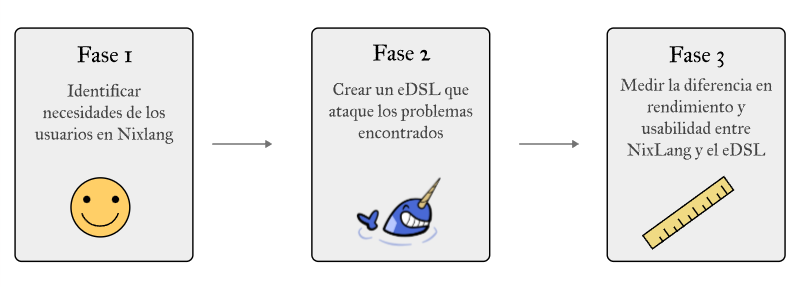
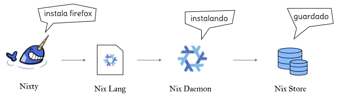
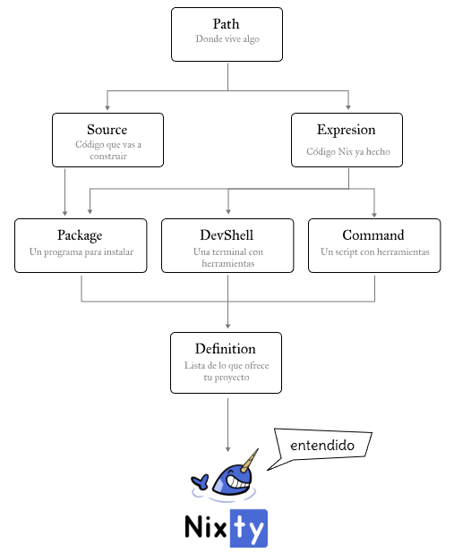
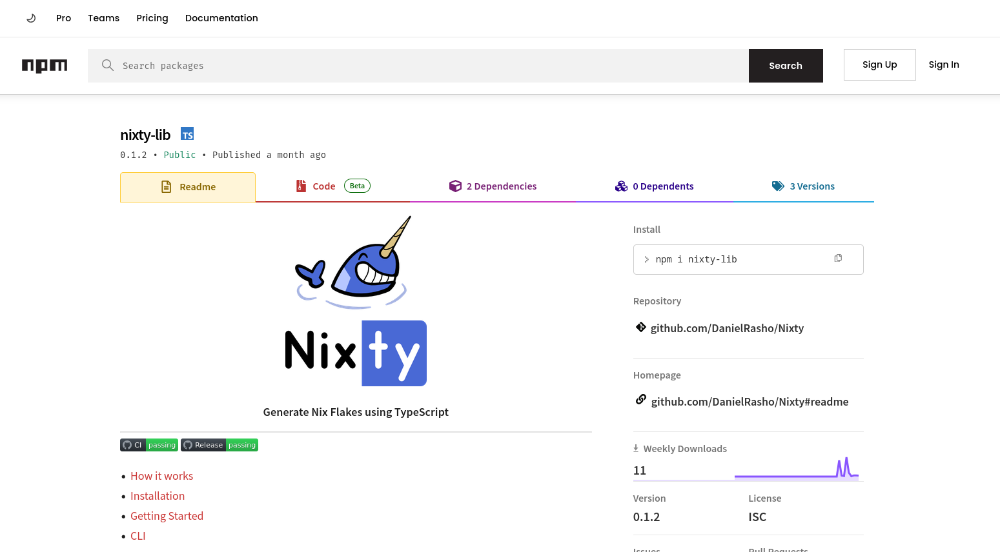
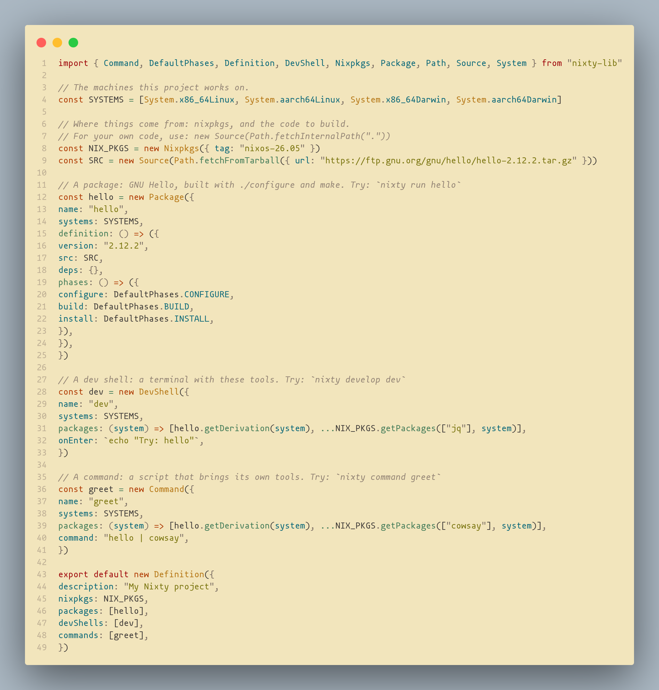
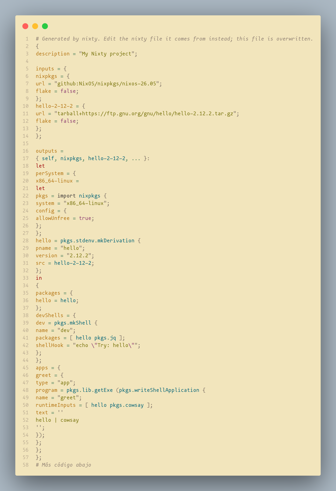
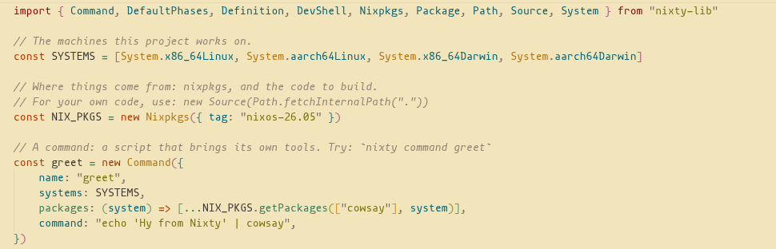
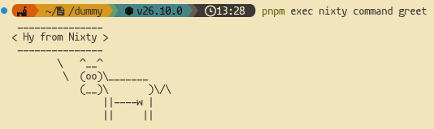
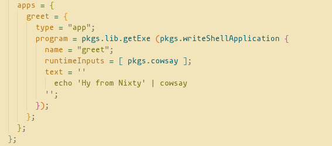
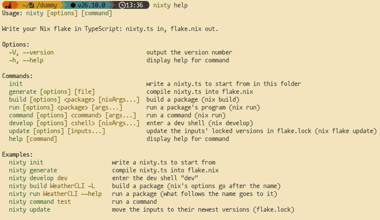

<h1 align="center">
    Nix para todos: Impacto del uso de un lenguaje de propósito general en la usabilidad de Nix
</h1>
<p align="center"><b>Daniel Alfredo Rayo Roldán </b></p>
<p align="center"><b>Carnet 22933</b></p>

Llevar _software_ de una computadora a otra y que siga funcionando, el llamado despliegue de _software_, sigue siendo un problema abierto en las Ciencias de la Computación: un programa no depende solo de su código fuente, sino también del contexto que lo rodea (_hardware_, sistema operativo, dependencias). Nix, el manejador de paquetes, lo aborda con un enfoque inspirado en la pureza funcional, en el que cada paquete declara explícitamente el contexto en el que se construye y se ejecuta. Así ha logrado producir más de 700 mil artefactos binariamente idénticos en distintas computadoras, mantener uno de los repositorios de paquetes más grandes que existen en linux e incluso describir casi todo un sistema operativo en un solo archivo de configuración.

Aun así, Nix no ha alcanzado la adopción de herramientas como Docker, Conda o VirtualEnv. Este trabajo investiga si ofrecer una forma de usar Nix desde un lenguaje de propósito general como TypeScript puede reducir la barrera de entrada para nuevos usuarios y mejorar su experiencia de uso. La investigación se dividió en tres fases:


<p align="center">
  
</p>

De la fase 2 nace Nixty, como alternativa de Typescript para escribir Nixlang; y en la fase 3, se encuentra el análisis estadístico comparativo con Nixlang, el código de ambos se encuentra en [`src/`](./src/)

---

## Contenido

1. [Documentos](#documentos)
2. [Nixty](#cómo-funciona-nixty)
3. [Tecnologías utilizadas](#tecnologías-utilizadas)
4. [Estructura del repositorio](#estructura-del-repositorio)
5. [Requisitos previos](#requisitos-previos)
6. [Instalación](#instalación)
7. [Ejecución](#ejecución)
8. [Capturas de pantalla](#capturas-de-pantalla)
9. [Video demo](#video-demo)

---

## Documentos
Los documentos importantes se pueden encontrar en las siguientes rutas:

| | Ubicación |
|---|---|
| 📄 Informe final | [`docs/informe_final.pdf`](./docs/informe_final.pdf) |
| ✍️ Consentimiento de uso de foto y video (firmado) | [`docs/consentimiento_firmado.pdf`](./docs/consentimiento_firmado.pdf) |
| 🎬 Video demo | [`demo/demo.mp4`](./demo/demo.mp4) |
| 🖼️ Capturas de pantalla | [`capturas/`](./capturas/) |
| 💻 Código fuente | [`src/`](./src/) |

---

## Nixty
Nixty fue el principal artefacto creado en este proyecto. Es un una librería que permite generar código de Nixlang con Typescript que después se puede usar para controlar Nix. El flujo de control se ve asi:

<p align="center">
  
</p>

1. El usuario escribe un archivo `nixty.ts` que exporta un `Definition` con sus paquetes (`Package`), entornos de desarrollo (`DevShell`) y comandos (`Command`).
2. Nixty verifica los tipos del archivo, lo ejecuta y traduce el resultado a un `flake.nix`.
3. Nix lee ese `flake.nix` y hace el trabajo real: descargar, construir e instalar.

El `flake.nix` generado es un archivo de Nix común: se puede leer, versionar y usar sin tener Nixty instalado.

### La Interfaz
Nixty funciona como piezas de Lego, usas unas piezas para crear otras más complejas, de esa manera todo empieza con un `Path`, y termina con una `Definition`.

A partir de un `Path`, puedes crear el resto de objetos en Nixty. Si tu Path representa un recurso para construir un paquete creas un  `Source` , si representa código de Nix que quieres usar, creas una `Expresion` . Al final todo es agrupado en un `Definition`, este último objeto es lo que Nixty interpreta. 

<p align="center">
  
</p>


## Tecnologías utilizadas

### Nixty

| Tecnología | Uso |
|---|---|
| TypeScript | Lenguaje de la API y del compilador; la verificación de tipos se hace con el compilador de TypeScript incluido en el paquete |
| Node.js (≥ 22) | Entorno de ejecución de la CLI |
| Commander | Interfaz de línea de comandos (`nixty`) |
| Nix (flakes) | Destino de la compilación; construye y ejecuta lo que Nixty describe |
| pnpm / npm | Distribución del paquete [`nixty-lib`](https://www.npmjs.com/package/nixty-lib) |
| Vitest | Pruebas |

### Análisis

| Tecnología | Uso |
|---|---|
| Python 3 y Jupyter | Entorno del análisis |
| pandas, NumPy | Limpieza y transformación de las respuestas |
| SciPy | Pruebas estadísticas (Shapiro-Wilk, Mann-Whitney U, correlación biserial de rangos) |
| matplotlib, seaborn | Gráficas |

---

## Estructura del repositorio

```
.
├── capturas/                     # capturas de pantalla (captura-01 … captura-10)
├── demo/
│   └── demo.mp4                  # video demostrativo
├── docs/
│   ├── informe_final.pdf         # informe final del proyecto
│   └── consentimiento_firmado.pdf
├── src/
│   ├── .env.example              # referencia de variables de entorno (no se requiere ninguna)
│   ├── nixty/                    # código fuente de Nixty (biblioteca + CLI)
│   │   ├── src/                  # compilador y comandos
│   │   ├── examples/             # proyectos de ejemplo
│   │   ├── test/                 # pruebas con Vitest
│   │   └── package.json
│   └── analysis/
│       └── main.ipynb            # análisis estadístico del estudio
└── README.md
```

---

## Requisitos previos

| Para… | Necesitas |
|---|---|
| Usar Nixty | [Nix](https://nixos.org/download) 2.4 o superior, [Node.js](https://nodejs.org) 22.18 o superior, [pnpm](https://pnpm.io/installation) y [Git](https://git-scm.com) |
| Ejecutar el análisis | Python 3.11 o superior y Git |

> [!NOTE]
> Nixty activa los *flakes* de Nix por su cuenta en cada comando, así que no hace falta cambiar la configuración de Nix.

### Variables de entorno

Ni Nixty ni el análisis requieren variables de entorno. El archivo [`src/.env.example`](./src/.env.example) se incluye solo como referencia.

---

## Instalación

### Nixty desde npm (recomendado)

1. Crea una carpeta para el proyecto y conviértela en repositorio de Git (Nix solo ve los archivos que Git rastrea):

   ```sh
   mkdir demo-nixty && cd demo-nixty
   git init
   pnpm init
   ```

2. Instala la biblioteca y crea el archivo de configuración de ejemplo:

   ```sh
   pnpm add -D nixty-lib
   pnpm exec nixty init     # crea nixty.ts
   ```

> [!TIP]
> Alternativa para usuarios de Nix, sin instalar nada: `nix run github:DanielRasho/Nixty -- --help`.

### Nixty desde el código fuente

1. Clona este repositorio y entra a la carpeta de Nixty:

   ```sh
   git clone https://github.com/DanielRasho/2026-22933-rayo-roldan-daniel-alfredo.git
   cd 2026-22933-rayo-roldan-daniel-alfredo/src/nixty
   ```

2. Instala las dependencias, compila y corre las pruebas:

   ```sh
   pnpm install
   pnpm build
   pnpm test
   ```

3. (Opcional) Haz el comando `nixty` disponible globalmente:

   ```sh
   pnpm link --global
   ```

### Análisis

1. Clona este repositorio (si no lo hiciste en el paso anterior):

   ```sh
   git clone https://github.com/DanielRasho/2026-22933-rayo-roldan-daniel-alfredo.git
   cd 2026-22933-rayo-roldan-daniel-alfredo
   ```

2. Crea un entorno virtual e instala las dependencias:

   ```sh
   python -m venv .venv
   source .venv/bin/activate
   pip install pandas numpy scipy matplotlib seaborn jupyter
   ```

---

## Ejecución

### Nixty

El `nixty.ts` que crea `nixty init` define un paquete (GNU Hello), un entorno de desarrollo y un comando. Para probarlos:

```sh
pnpm exec nixty generate     # escribe flake.nix a partir de nixty.ts
git add -A                   # Nix ignora los archivos que Git no rastrea

pnpm exec nixty command greet   # ejecuta un comando con sus propias herramientas
pnpm exec nixty run hello       # construye el paquete y ejecuta el programa
pnpm exec nixty develop dev     # abre una terminal con hello y jq disponibles
```

La primera ejecución tarda unos minutos porque Nix descarga nixpkgs y compila GNU Hello. `nixty command greet` debería imprimir:

```
 _______________
< Hello, world! >
 ---------------
        \   ^__^
         \  (oo)\_______
            (__)\       )\/\
                ||----w |
                ||     ||
```

Cada comando regenera `flake.nix` antes de ejecutarse, así que después de editar `nixty.ts` basta con volver a correrlo. Hay más ejemplos en [`src/nixty/examples/`](./src/nixty/examples/).

### Análisis

> [!IMPORTANT]
> **Privacidad:** los datos de los participantes **no** están en el repositorio. El notebook se publica con los resultados de su última ejecución, así que se puede leer el análisis completo sin volver a correrlo.

Para ver el notebook:

```sh
source .venv/bin/activate
jupyter notebook src/analysis/main.ipynb
```

Para volver a ejecutarlo hace falta colocar los datos en `src/analysis/data/` con esta estructura:

```
src/analysis/data/
├── phase1/
│   └── demographics.csv                     # perfil de los participantes de la fase exploratoria
└── phase3/
    └── nixty-survey-answers-<fecha>.csv     # respuestas del estudio, una fila por respuesta
```

Columnas que espera cada archivo:

- `demographics.csv`: índice (código del participante), `Edad`, `Semestre`, `Tienes experiencia con manejadores de paquetes`, `Has empaquetado`, `Lenguajes`.
- `nixty-survey-answers-<fecha>.csv`: `username`, `survey_order`, `step`, `step_position`, `section`, `question_id`, `kind`, `item_id`, `option_id`, `value`, `is_correct`, `answered_at`, `time_ms`.

Con los datos en su lugar, ejecuta todas las celdas desde Jupyter (*Run → Run All Cells*).

---

## Capturas de pantalla

| # | Descripción | Captura |
|---|---|---|
| 01 | Paquete `nixty-lib` publicado en npm |  |
| 02 | `nixty.ts` de ejemplo generado por `nixty init` |  |
| 03 | `flake.nix` generado por Nixty a partir del ejemplo |  |
| 04 | Definición de un comando personalizado en TypeScript |  |
| 05 | Ejecución del comando con `nixty command greet` |  |
| 06 | Fragmento del `flake.nix` generado para el comando |  |
| 07 | Ayuda de la CLI (`nixty help`) |  |

---

## Video demo

🎬 [Ver el video demostrativo (`demo/demo.mp4`)](./demo/demo.mp4)
